# autotube: a free robot that runs a YouTube and Instagram channel

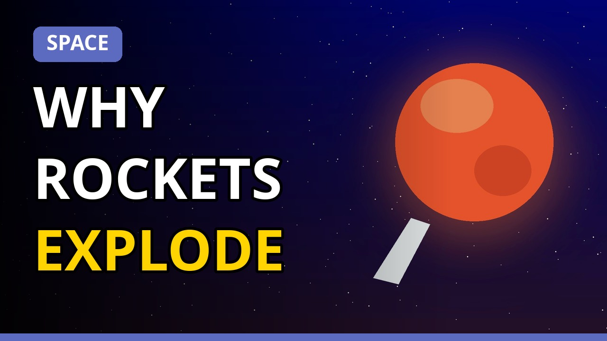

**Every day at 8:00 AM, this project publishes a new educational video, a YouTube Short and an Instagram Reel on its own.**
It runs on GitHub's free computers, so your own computer and phone do not need to be on. It costs nothing.

> **New to all this?** Read the full picture guide: [docs/autotube-guide.pdf](docs/autotube-guide.pdf) (38 pages, plain English, with diagrams and every line of code explained).

---

## What you get every day

| Item | Details |
|---|---|
| Long video | 3 to 4 minutes, Full HD, title, description, tags, custom thumbnail, topic playlist |
| Short | About 40 seconds, vertical, placed in a "Daily Shorts" playlist |
| Instagram Reel | The same Short, with a caption |
| Topic | 1 of 10 topics (cars, space, aeroplanes, AI and machine learning, science, tech, engineering, inventions, earth, nature). Rotates. Titles never repeat |
| Language | Hindi or English (one setting) |

## How it works

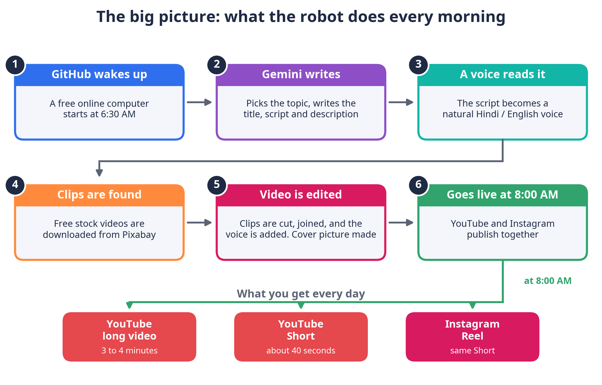

1. **GitHub wakes up** at 6:30 AM India time and starts a free computer.
2. **Gemini** (Google's AI) writes the title, script, description and tags.
3. **edge-tts** reads the script aloud in Hindi or English.
4. **Pixabay** supplies free stock video clips.
5. **FFmpeg** cuts and joins the clips and adds the voice. **Pillow** draws the thumbnail.
6. **YouTube** and **Instagram** receive the posts. Everything goes live at exactly 8:00 AM.

## A day in the life

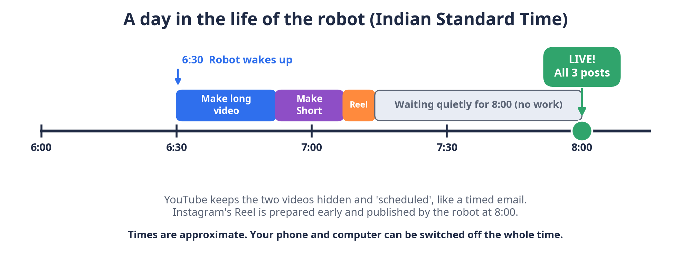

YouTube keeps the videos hidden and *scheduled* until 8:00. The robot prepares the Instagram Reel early, waits, and publishes it at 8:00. If the robot is very late, it simply publishes immediately.

| India time | World time (UTC) | What happens |
|---|---|---|
| 6:30 AM | 01:00 | The robot wakes up (`cron` in `.github/workflows/daily.yml`) |
| 8:00 AM | 02:30 | Everything goes live (`publish_time` in `main.py`) |

## Meet the team

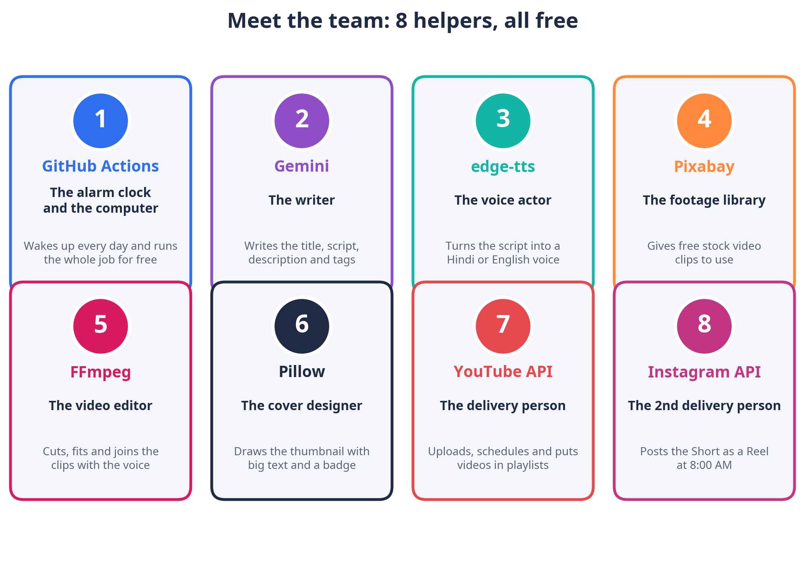

| Helper | Job | Free? |
|---|---|---|
| GitHub Actions | Runs everything on a schedule | Yes (public repo) |
| Gemini | Writes the content | Free tier |
| edge-tts | Makes the voice | Yes |
| Pixabay | Free video clips | Yes |
| FFmpeg | Edits the video | Yes |
| Pillow | Draws the thumbnail | Yes |
| YouTube API | Uploads, schedules, playlists | Free quota |
| Instagram API | Posts the Reel | Free |

## Inside one video

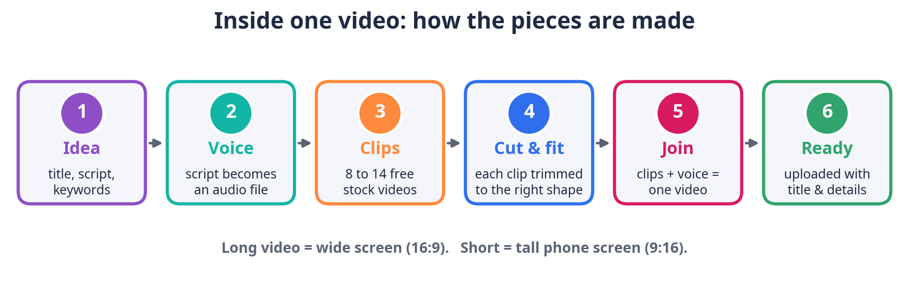

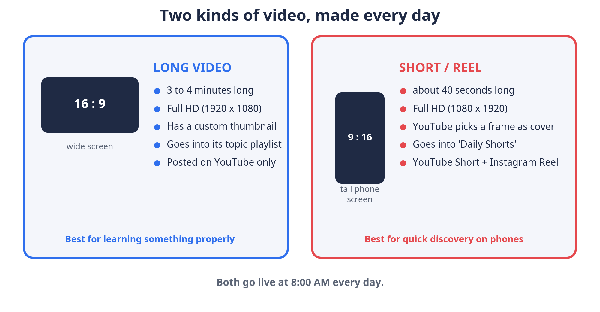

## Topics and playlists

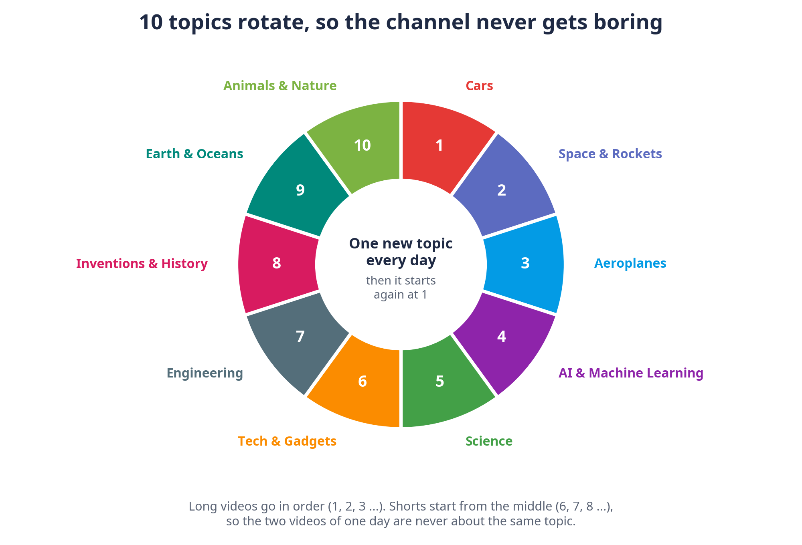

Long videos go into a playlist named after their topic. Shorts go into **Daily Shorts**. Playlists are created automatically the first time. `history.txt` remembers every title so nothing repeats.

## Thumbnails

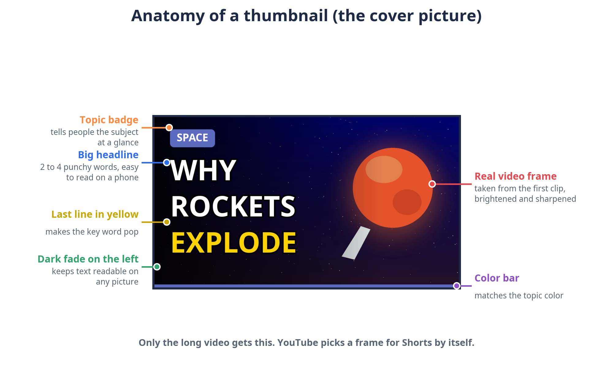

## Keys and safety

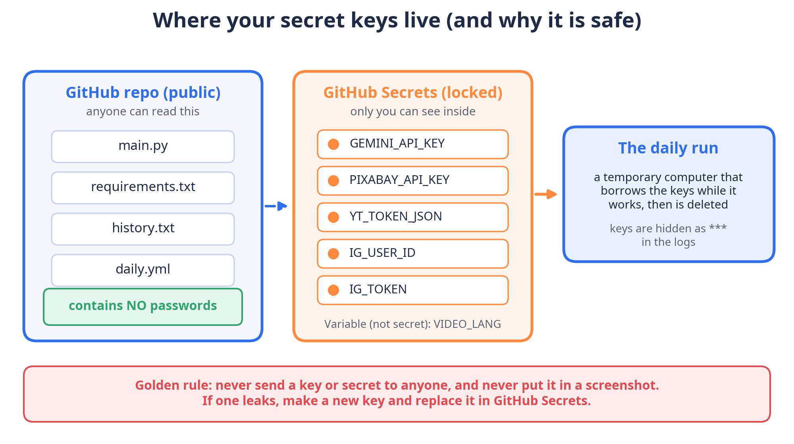

Keys are stored only in **Settings > Secrets and variables > Actions**. They are never inside the code. **Never share a key, post it, or put it in a screenshot.** If a key leaks, make a new one and replace the secret.

Keep the repository **Public**: public repositories get free running time, and the daily run includes a wait until 8:00.

| Secret name | Comes from |
|---|---|
| `GEMINI_API_KEY` | [Google AI Studio](https://aistudio.google.com) |
| `PIXABAY_API_KEY` | [Pixabay API docs](https://pixabay.com/api/docs/) |
| `YT_TOKEN_JSON` | `tools/get_token.py` (Google login) |
| `IG_USER_ID` | `tools/get_ig.py` |
| `IG_TOKEN` | `tools/get_ig.py` |

Variable (not secret): `VIDEO_LANG` = `hi` for Hindi or `en` for English.

## Set it up yourself (one time)

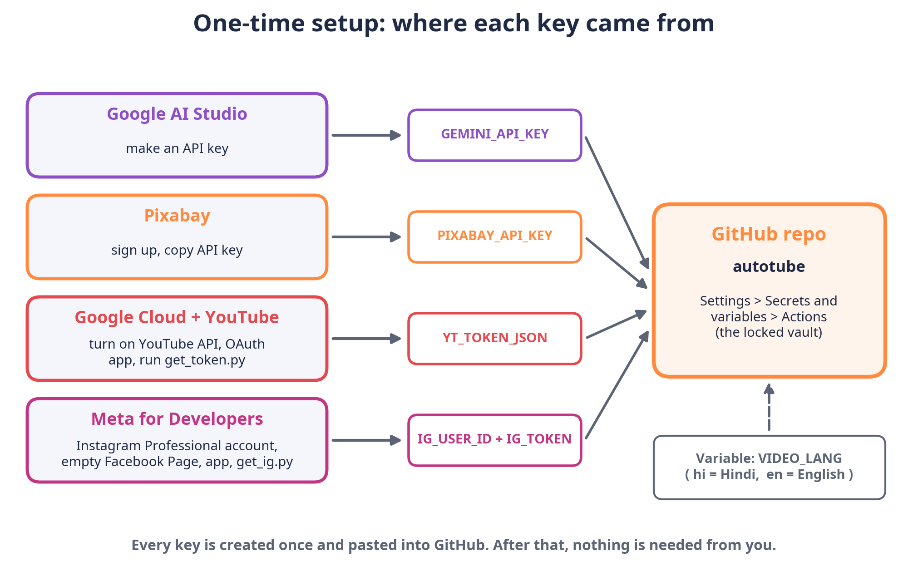

1. **GitHub**: copy this repository (Fork) and keep it public.
2. **Gemini key**: [aistudio.google.com](https://aistudio.google.com) > Get API key.
3. **Pixabay key**: sign up at [pixabay.com](https://pixabay.com) and copy the key from the API docs page.
4. **YouTube**: in [Google Cloud Console](https://console.cloud.google.com) make a project, enable **YouTube Data API v3**, set up the OAuth consent screen (fill Branding, publish the app, add the scope `https://www.googleapis.com/auth/youtube`), create an **OAuth client of type Desktop app** and download it as `client_secret.json`.
5. **Install Python** on your PC (tick *Add python.exe to PATH*), then in the folder with `client_secret.json` run:
   `pip install google-auth-oauthlib` and then `python tools/get_token.py`. Log in with the channel's Google account and press Allow. Copy the contents of the new `token.json` into the secret `YT_TOKEN_JSON`.
6. **Instagram** (optional): switch the account to Professional (Creator), create an empty Facebook Page and link it, create an app at [developers.facebook.com](https://developers.facebook.com) with the Instagram permissions (`instagram_basic`, `instagram_content_publish`, `pages_show_list`, `pages_read_engagement`, `business_management`), make a user token in Graph API Explorer, then run `python tools/get_ig.py`. Put the two values from `ig_keys.txt` into the secrets `IG_USER_ID` and `IG_TOKEN`. The robot never posts on Facebook.
7. **Add the secrets and the variable** listed above.
8. **Test**: Actions tab > **daily-video** > **Run workflow**. A green tick means success.

## Files in this repository

| File | What it is |
|---|---|
| `main.py` | The program (the brain of the robot) |
| `requirements.txt` | The Python tools it needs |
| `.github/workflows/daily.yml` | The schedule and the steps GitHub follows |
| `history.txt` | The memory of past titles and topics |
| `tools/get_token.py` | One-time helper for the YouTube permission |
| `tools/get_ig.py` | One-time helper for the Instagram keys |
| `docs/` | The guide (PDF) and the pictures |

Every line of every file is explained in plain words in the **Appendix** of [the PDF guide](docs/autotube-guide.pdf).

## If something goes wrong

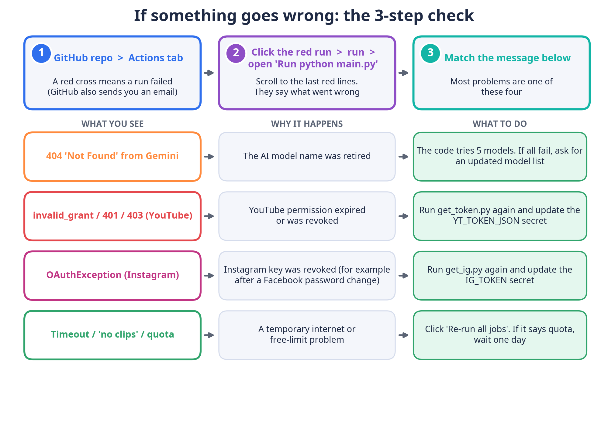

1. Open the **Actions** tab. A red cross means a run failed. GitHub also sends an email.
2. Click the red run > **run** > open **Run python main.py** and read the last red lines.
3. Match the message:

| Message | Meaning | Fix |
|---|---|---|
| 404 Not Found (Gemini) | An AI model name was retired | The code tries 5 models. If all fail, update `MODELS` in `main.py` |
| `invalid_grant`, 401, 403 (YouTube) | The YouTube permission expired or was revoked | Run `get_token.py` again and update `YT_TOKEN_JSON` |
| `OAuthException` (Instagram) | The Instagram key was revoked | Run `get_ig.py` again and update `IG_TOKEN` |
| Timeout, no clips, quota | A temporary or free-limit problem | Press **Re-run all jobs**, or wait one day |

## Questions

- **Do I need my computer on?** No.
- **How do I pause it?** Actions > daily-video > three dots > *Disable workflow*.
- **How do I run it now?** Actions > daily-video > *Run workflow* (publishes immediately in the daytime).
- **How do I change the language?** Settings > Secrets and variables > Actions > Variables > `VIDEO_LANG`.
- **How do I change the time?** Edit the `cron` line in `daily.yml` and the `02:30` in `publish_time` in `main.py` (times are in UTC; India is UTC+5:30).
- **Are the facts always right?** The AI is told to use only well-known facts, but it can make mistakes. Check videos regularly.

## Good to know

- Fully automatic content can be treated as repetitive by YouTube, which may limit monetization. Check Studio messages and consider adding your own touch.
- YouTube emails the owner of the channel's Google account about copyright claims and guideline problems.
- This is an educational project and is not affiliated with Google, YouTube, Meta, GitHub or Pixabay. Follow each service's rules.
